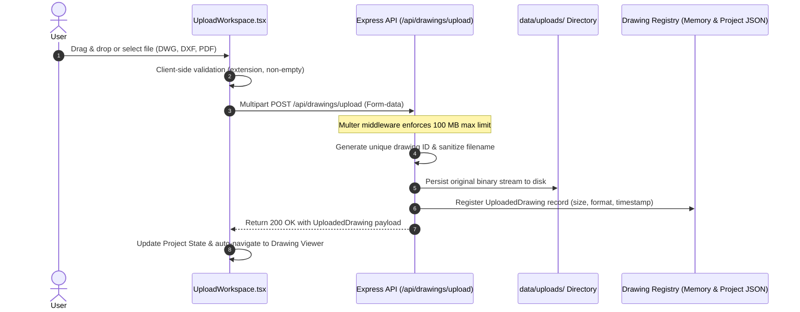

# Phase 1: File Upload & Drawing Validation Architecture

This document outlines the file upload architecture, format requirements, validation mechanisms, storage lifecycles, and API contracts used in RailSpec KAVACH Studio (X-Tractor).

---

## 1. Overview & Supported Formats

The upload pipeline serves as the primary ingress point for railway engineering drawings. It accepts three major drawing formats commonly used across Indian Railways signaling and engineering divisions:

| Format | Extension | Description | Typical Source Systems |
| :--- | :--- | :--- | :--- |
| **AutoCAD Drawing Database** | `.dwg` | Native binary format containing complete CAD entity trees, block insertions, and attributes. Supports AutoCAD R13 (AC1012) through AutoCAD 2018/2021 (AC1032). | AutoCAD, Civil 3D, MicroStation |
| **Drawing Exchange Format** | `.dxf` | Standardized ASCII or binary CAD interchange format structured into sequential group codes. | AutoCAD Export, Bentley MicroStation, QCAD |
| **Vector / Raster PDF** | `.pdf` | Multi-page or wide-strip vector engineering drawings, Signalling Interlocking Plans (SIP), Table of Control (TOC) sheets, and RFID track layout plans. | Exported CAD PDFs, Scanned blueprints, Field surveys |

---

## 2. Ingress Architecture & Lifecycle Flow



---

## 3. Frontend Ingress: `UploadWorkspace.tsx`

The upload user interface is implemented in [`src/components/UploadWorkspace.tsx`](file:///c:/Users/shiva/OneDrive/Desktop/WORK/railspectest/src/components/UploadWorkspace.tsx).

### Key Features:
* **Drag-and-Drop Dropzone:** Listens for `dragover`, `dragleave`, and `drop` events on the central drop area.
* **Format Filtering:** The native file picker restricts selection using `accept=".dwg,.dxf,.pdf"`.
* **Upload State Feedback:** Displays live progress text: `"Validating & Parsing Drawing Borders & Geometry..."`.
* **Drawing Management:** Shows a tabular list of all uploaded drawings associated with the active project, including:
  * File format icon (`FileCode2` for CAD, `FileText` for PDF).
  * Drawing file name and size in MB.
  * Upload timestamp.
  * Quick actions: **View in Canvas** and **Remove Drawing**.

---

## 4. Backend Processing & Multer Configuration: `server.ts`

The upload backend endpoint is declared in [`server.ts`](file:///c:/Users/shiva/OneDrive/Desktop/WORK/railspectest/server.ts).

### Endpoint Specification:
* **Route:** `POST /api/drawings/upload`
* **Content-Type:** `multipart/form-data`
* **Form Field Name:** `file`
* **Max Payload Size:** `100 MB` (configured via Multer `limits: { fileSize: 100 * 1024 * 1024 }`)
* **Storage Location:** `<WORKSPACE_ROOT>/data/uploads/`

### Validation Steps:
1. **File Existence Check:** Validates that `req.file` exists and was buffered/streamed cleanly.
2. **File Size Check:** Rejects requests with HTTP 400 if file size exceeds 100 MB.
3. **Format Detection:** Inspects file extension and initial binary headers:
   * `.dwg` $\rightarrow$ Assigned format `'dwg'`
   * `.dxf` $\rightarrow$ Assigned format `'dxf'`
   * `.pdf` $\rightarrow$ Assigned format `'pdf'`
4. **Sanitized Storage:** Files are written to disk using timestamp-prefixed UUIDs to prevent directory traversal and namespace collisions.

---

## 5. Data Contract: `UploadedDrawing`

Upon successful upload, the backend creates and returns an `UploadedDrawing` data object:

```typescript
export interface UploadedDrawing {
  id: string;               // Unique drawing identifier (e.g., "drw_1795603817798")
  fileName: string;         // Original file name (e.g., "Chitgidda_Layout.pdf")
  format: 'dwg' | 'dxf' | 'pdf'; // Normalized format enum
  fileSize: number;         // Size in bytes
  uploadedAt: string;       // ISO 8601 UTC timestamp
  filePath: string;         // Relative or absolute path in data/uploads/
  pageCount?: number;       // Total pages (default 1 for CAD, >= 1 for PDF)
  bounds?: {                // Calculated content bounding box in points/units
    minX: number;
    minY: number;
    maxX: number;
    maxY: number;
    width: number;
    height: number;
  };
}
```

---

## 6. Project State Integration

When a drawing is uploaded:
1. **Primary Layout Selection:** If no primary drawing is active, the newly uploaded drawing is immediately set as the active layout.
2. **Stale Metadata Invalidation:** As enforced in [`src/App.tsx`](file:///c:/Users/shiva/OneDrive/Desktop/WORK/railspectest/src/App.tsx#L259-L279), uploading a new primary drawing clears any stale station metadata from previous layouts, ensuring clean isolation between different stations.
3. **Persistence:** The drawing list is appended to the current project schema in `data/projects/<projectId>.json`.
