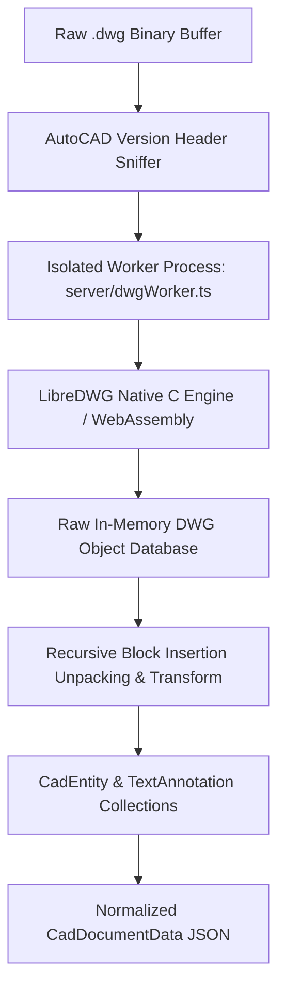
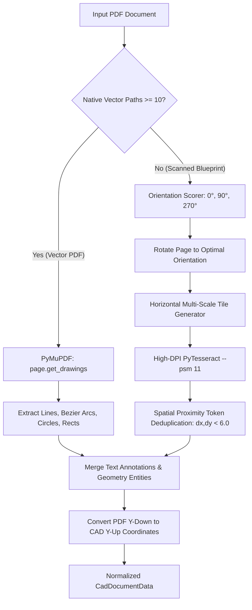

# Phase 2: File Parsing, Conversion & Normalization Engine

This document details the parsing, geometric conversion, and data normalization pipelines that transform raw DWG, DXF, and PDF files into a unified CAD Document Object Model (`CadDocumentData`).

---

## 1. Normalization Target: Unified CAD Document Object Model

Regardless of whether the input is a binary AutoCAD DWG, an ASCII DXF, or a vector/scanned PDF, all files are normalized into a standardized in-memory schema:

```typescript
export interface CadDocumentData {
  fileName: string;
  cadVersion: string;         // e.g., "AutoCAD 2018 (AC1032)" or "Vector PDF (PyMuPDF)"
  bounds: CadBounds;          // minX, minY, maxX, maxY, width, height
  layers: CadLayer[];         // Name, color, visibility, entity count
  entities: CadEntity[];       // Lines, Polylines, Circles, Arcs, Solids, Text
  textAnnotations: TextAnnotation[]; // Cleaned texts with position, rotation, height
  parseWarnings: string[];
}
```

### Core Entities:
* **`LINE` / `LWPOLYLINE` / `POLYLINE`:** Point arrays representing track rails, platform edges, and electrical boundaries.
* **`CIRCLE` / `ARC`:** Signal lamps, circular indicators, and track curves.
* **`SOLID`:** Filled triangles representing RFID tag direction indicators.
* **`TEXT` / `MTEXT`:** Station names, signal IDs, point numbers, chainage kilometer markers, and track names.

---

## 2. DWG Conversion Pipeline: `cadParser.ts` & `dwgWorker.ts`

The DWG processing engine handles proprietary binary AutoCAD drawing files.



### Key Technical Implementations:
1. **Isolated Worker Process:**
   * DWG binary decoding is sandboxed in [`server/dwgWorker.ts`](file:///c:/Users/shiva/OneDrive/Desktop/WORK/railspectest/server/dwgWorker.ts).
   * Spawning a separate Node.js worker prevents potential memory leaks or segmentation faults in C-level parsers from crashing the main Express HTTP server.
2. **Version Sniffing:**
   * Reads the first 6 bytes of the binary header to detect AutoCAD versions:
     * `AC1015` $\rightarrow$ AutoCAD 2000
     * `AC1018` $\rightarrow$ AutoCAD 2004
     * `AC1024` $\rightarrow$ AutoCAD 2010
     * `AC1027` $\rightarrow$ AutoCAD 2013
     * `AC1032` $\rightarrow$ AutoCAD 2018/2021
3. **Block Reference Flattening & Affine Transformations:**
   * CAD drawings frequently encapsulate signals and turnout symbols in `INSERT` block entities.
   * The parser calculates recursive 2D affine matrix compositions:
     $$\begin{bmatrix} x' \\ y' \\ 1 \end{bmatrix} = \begin{bmatrix} s_x \cos\theta & -s_y \sin\theta & t_x \\ s_x \sin\theta & s_y \cos\theta & t_y \\ 0 & 0 & 1 \end{bmatrix} \begin{bmatrix} x \\ y \\ 1 \end{bmatrix}$$
   * Child coordinates are mapped into root station coordinates with preserved scale, rotation, and offsets.

---

## 3. DXF Conversion Pipeline: `cadParser.ts`

The DXF conversion pipeline parses ASCII and binary DXF files using `dxf-parser` enhanced by a custom supplementary group-code scanner in [`server/cadParser.ts`](file:///c:/Users/shiva/OneDrive/Desktop/WORK/railspectest/server/cadParser.ts).

### Key Technical Implementations:
1. **Bulge Arc Polyline Conversion:**
   * AutoCAD stores curved polyline segments using a scalar `bulge` property:
     $$\text{bulge} = \tan\left(\frac{\theta}{4}\right)$$
     where $\theta$ is the included angle of the circular arc.
   * The parser computes the arc radius, center, start angle, and sweep, sampling the curve into discrete linear segments for rendering and spatial querying:
     $$\text{sagitta} = \frac{\text{chord}}{2} \cdot \text{bulge}$$
2. **MText Formatting Parsing:**
   * Strips AutoCAD formatting codes such as `\A1;`, `\C1;`, `\fArial|b0|i0;`, `\P` (paragraph breaks), and curly-bracket grouping enclosures to extract pure signaling text tokens (e.g., `"S-12"`, `"17A"`, `"R-704"`).

---

## 4. PDF Vector & Raster OCR Pipeline: `pdfProcessor.ts` & `pdfOcrWorker.py`

When PDFs are uploaded, [`server/pdfProcessor.ts`](file:///c:/Users/shiva/OneDrive/Desktop/WORK/railspectest/server/pdfProcessor.ts) invokes Python's PyMuPDF (`fitz`) and PyTesseract via [`server/pdfOcrWorker.py`](file:///c:/Users/shiva/OneDrive/Desktop/WORK/railspectest/server/pdfOcrWorker.py).



### Key Technical Implementations:
1. **Vector Drawing Extraction (`page.get_drawings()`):**
   * High-precision extraction of native vector shapes directly from the PDF content stream.
   * Bézier curve segments (`c` items in drawing paths) are evaluated using cubic Bernstein polynomials:
     $$B(t) = (1-t)^3 P_0 + 3(1-t)^2 t P_1 + 3(1-t) t^2 P_2 + t^3 P_3, \quad t \in [0, 1]$$
2. **Auto-Orientation Detection:**
   * Tall drawings (such as `1134×4414 pt`) or wide landscape banners are evaluated at 0°, 90°, and 270° rotations.
   * A low-DPI OCR pass scans each orientation and assigns keyword density scores (awarding points for railway terms such as `STATION`, `SIGNAL`, `NOMINAL`, `RFID`, `TIN`, `KM`). The highest-scoring orientation is locked in.
3. **Multi-Scale Horizontal Strip Tiling:**
   * Long linear station layouts are sliced into overlapping horizontal tiles at 550–650 DPI.
   * Executed with PyTesseract configuration `--psm 11` (Sparse Text Layout Analysis) to read small 3pt CAD fonts without character confusion (e.g., distinguishing `N-46` from `P-46`).
4. **Coordinate Space Inversion (PDF to CAD):**
   * Standard PDF coordinates place $(0,0)$ at the top-left with $Y$ increasing downward.
   * Standard CAD/Cartesian coordinates place $(0,0)$ at the bottom-left with $Y$ increasing upward.
   * The conversion pipeline inverts all $Y$ coordinates:
     $$y_{\text{CAD}} = H_{\text{page}} - y_{\text{PDF}}$$
