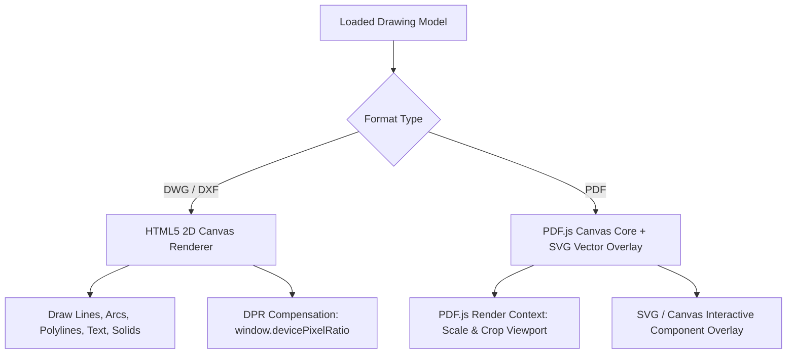

# Phase 3: Drawing Processing, Interactive Display & Metadata Strip

This document details how converted drawings are rendered, inspected, navigated, and displayed within the **Drawing Viewer** workspace ([`src/components/DrawingViewer.tsx`](file:///c:/Users/shiva/OneDrive/Desktop/WORK/railspectest/src/components/DrawingViewer.tsx)).

---

## 1. Dual Rendering Engines

The drawing viewer utilizes two rendering pipelines depending on whether the loaded document is a CAD file (DWG/DXF) or a PDF layout:



### 1. HTML5 2D Canvas Engine (for DWG / DXF):
* Renders millions of vertices at 60 FPS using hardware-accelerated 2D canvas contexts.
* Compensates for High-DPI (Retina/4K) displays by scaling the internal canvas pixel buffer with `window.devicePixelRatio`.
* Renders CAD layers with original AutoCAD Color Index (ACI) palette mappings ([`server/aciPalette.ts`](file:///c:/Users/shiva/OneDrive/Desktop/WORK/railspectest/server/aciPalette.ts)).

### 2. PDF.js Engine with Vector Overlay (for PDF):
* Employs PDF.js to render native vector layers and raster text at high fidelity.
* Projects interactive bounding boxes and vector overlays directly on top of the rendered PDF sheet.

---

## 2. Dynamic Station Metadata Strip

Located above the drawing canvas, the **Metadata Strip** dynamically summarizes the station attributes detected from the active layout sheet:

```
+----------------------------------------------------------------------------------------------------------------------+
| STATION NAME: CHITGIDDA | STATION CODE: [CTF] | STATION ID: [520] | KM DETAILS: [KM 121.80] | Division: Secunderabad |
+----------------------------------------------------------------------------------------------------------------------+
```

### Detection & Isolation Lifecycle:
1. **Asynchronous Query:** When a drawing or page is selected, the frontend invokes `GET /api/drawings/:id/metadata?page=<pageNumber>`.
2. **Prioritization Rule:** The viewer always prioritizes `detectedMeta` (the live metadata of the currently selected drawing) ahead of `project.metadata`.
3. **Switch Isolation:** Whenever a user uploads or switches to a different station drawing, previous metadata is invalidated immediately so that details from another station never bleed into the view.

---

## 3. High-Precision Pan, Zoom & Viewport Controls

Railway layout plans are extremely wide linear strips (often exceeding aspect ratios of 10:1 or 20:1, with physical lengths reaching 4400 points). The viewer supports ultra-deep inspection:

* **Zoom Range:** 100% up to **5500%** maximum zoom.
* **Pan Operations:** Click-and-drag mouse panning across both X and Y axes.
* **Wheel Zoom:** Dynamic mouse wheel zooming centered on the current cursor position.
* **Preset Zoom Shortcuts:**
  * **100%:** Standard 1:1 view.
  * **Fit:** Fits the entire drawing content bounds into the available viewport window.
  * **Rotate:** 90° clockwise rotation toggle.
  * **Quick Zoom Anchors:** Direct jump buttons for `500%`, `1500%`, `3000%`, and `5500%`.

---

## 4. Coordinate Transformations: Screen $\leftrightarrow$ World CAD

To perform hit-testing, tooltips, and interactive measurements, the viewer continuously converts between viewport screen pixels and world CAD units.

```
       Screen Space (Pixels)                    World CAD Space (Units/Meters)
    (0,0) Top-Left                             Y ^
      +-------------------+                      |      +------------------+
      |                   |                      |      |  Railway Track   |
      |   (sx, sy)        |      <=======>       |      |  (wx, wy)        |
      |         *         |                      |      +------------------+
      +-------------------+                      +-------------------------> X
                       (W, H)                 (0,0)
```

### Mathematical Formulas:

#### Screen to World Coordinate Conversion:
$$w_x = \frac{s_x - \text{offsetX}}{\text{scale}} + \text{minX}$$
$$w_y = \text{maxY} - \frac{s_y - \text{offsetY}}{\text{scale}}$$

#### World to Screen Coordinate Conversion:
$$s_x = (w_x - \text{minX}) \cdot \text{scale} + \text{offsetX}$$
$$s_y = (\text{maxY} - w_y) \cdot \text{scale} + \text{offsetY}$$

where:
* $\text{minX}, \text{maxY}$ are the drawing bounds.
* $\text{scale}$ is the active scale factor ($\text{fitScale} \times \text{activeZoom}$).
* $\text{offsetX}, \text{offsetY}$ are the pan translations in viewport pixels.

---

## 5. Entity Hit-Testing & Layer Inspector

* **Scale-Invariant Hit-Testing:**
  * When a user hovers or clicks on the canvas, the hit-test tolerance adjusts inversely with zoom:
    $$\text{tolerance}_{\text{world}} = \frac{14\text{ px}}{\text{scale}}$$
  * This guarantees that small components (such as RFID triangle tags or signal circles) remain equally easy to click whether viewed at 100% or 5500% zoom.
* **Layer Toggling:**
  * The inspector panel exposes CAD layers (`0`, `TRACK`, `SIGNALS`, `TAGS`, `TEXT`, `BOUNDARY`), allowing users to selectively toggle layers for clutter-free verification.

---

## 6. Triggering Extraction Engine

The top-right header features the primary call-to-action: **Start Extraction**. Clicking this button:
1. Packages the drawing reference, page number, and detected coordinate bounds.
2. Dispatches `POST /api/extract` to execute the full RDSO Kavach Table extraction algorithms.
3. Automatically transitions the active workspace from **Drawing Viewer** to **Extraction Workspace** and **Generated Tables**.
