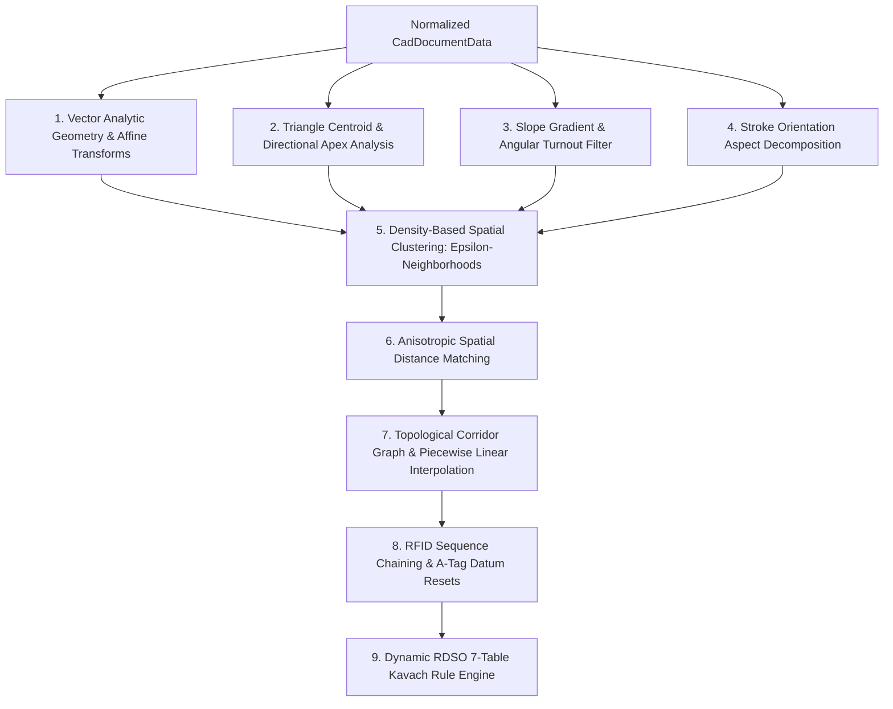

# Phase 4: RDSO Kavach Extraction Algorithms & Mathematical Foundations

This document provides a comprehensive technical and mathematical explanation of the algorithms used in RailSpec KAVACH Studio for railway layout extraction, component recognition, topological route linking, and Table of Control (TOC) generation.

---

## 1. Direct Assessment of Classical Computer Vision / Estimation Algorithms

| Algorithm | Status in Engine | Engineering Justification & Realized Alternative |
| :--- | :---: | :--- |
| **Hough Transform** | ❌ **Not Used** | Hough Transform is a voting technique designed for noisy raster images (`cv2.HoughLines`, `cv2.HoughCircles`). Because railway layouts are ingested as vector CAD (`.dwg`, `.dxf`) or vector PDF (`.pdf`), lines, circles, and curves are already defined by exact vector endpoints and radii. Applying Hough Transform would rasterize clean vectors into pixels, introducing unnecessary discretization error. |
| **DBSCAN Clustering** | 🟡 **Custom Variant Used** | The third-party `scikit-learn` DBSCAN library is not imported, but the core **Density-Based Spatial Clustering ($\epsilon$-neighborhood + connected-component expansion)** is implemented natively in TypeScript and Python for grouping signal heads, deduplicating OCR tokens across tiles, and resolving track corridors. |
| **Kalman Filtering** | ❌ **Not Used** | Kalman Filtering is an optimal recursive estimator for noisy time-series sensor tracking (such as live train GPS/odometry estimation over time). Layout extraction is a **static, offline geometric and topological network graph problem**. Instead of probabilistic state prediction, the engine uses **deterministic topological corridor graph traversal and linear path interpolation**. |

---

## 2. Full Inventory of Active Algorithms & Mathematical Models

---

### Algorithm 1: 2D Affine Transformations & Block Decomposition
* **Code Reference:** [`server/cadParser.ts#L123-L140`](file:///c:/Users/shiva/OneDrive/Desktop/WORK/railspectest/server/cadParser.ts#L123-L140), [`server/pdfProcessor.ts#L49-L65`](file:///c:/Users/shiva/OneDrive/Desktop/WORK/railspectest/server/pdfProcessor.ts#L49-L65)
* **Mathematical Model:**
  Nested CAD blocks (`INSERT` entities) and PDF Form XObjects require projecting local component coordinates into global yard coordinates. A 2D affine transformation matrix $M$ is computed:
  $$\begin{bmatrix} X_{\text{world}} \\ Y_{\text{world}} \\ 1 \end{bmatrix} = \begin{bmatrix} s_x \cos\theta & -s_y \sin\theta & t_x \\ s_x \sin\theta & s_y \cos\theta & t_y \\ 0 & 0 & 1 \end{bmatrix} \begin{bmatrix} X_{\text{local}} \\ Y_{\text{local}} \\ 1 \end{bmatrix}$$
* **Application:** Resolves multi-lamp signal posts, RFID balise blocks, and turnout switch symbols regardless of nesting depth.

---

### Algorithm 2: Triangle Centroid & Directional Apex Classification (RFID Facing)
* **Code Reference:** [`server/cadComponentExtractor.ts#L447-L488`](file:///c:/Users/shiva/OneDrive/Desktop/WORK/railspectest/server/cadComponentExtractor.ts#L447-L488)
* **Mathematical Model:**
  RFID balises are drawn as equilateral or isosceles triangles pointing in the direction of train travel (Nominal = RIGHT $+X$, Reverse = LEFT $-X$).
  1. For vertices $P_0, P_1, P_2$, the centroid is computed:
     $$C = \left(\frac{x_0 + x_1 + x_2}{3}, \frac{y_0 + y_1 + y_2}{3}\right)$$
  2. Edge lengths $d_{01}, d_{12}, d_{20}$ are calculated via Euclidean distance:
     $$d_{ij} = \sqrt{(x_i - x_j)^2 + (y_i - y_j)^2}$$
  3. The apex vertex $P_{\text{apex}}$ is identified as the vertex with maximum horizontal deviation from the centroid:
     $$\Delta x_{\text{max}} = \max_i |x_i - C_x|$$
  4. Facing direction is assigned:
     $$\text{Facing} = \begin{cases} \text{RIGHT (Nominal)} & \text{if } x_{\text{apex}} > C_x \\ \text{LEFT (Reverse)} & \text{if } x_{\text{apex}} < C_x \end{cases}$$

---

### Algorithm 3: Turnout Slope Gradient & Angular Normalization
* **Code Reference:** [`server/cadComponentExtractor.ts#L502-L525`](file:///c:/Users/shiva/OneDrive/Desktop/WORK/railspectest/server/cadComponentExtractor.ts#L502-L525)
* **Mathematical Model:**
  Turnouts and crossovers connect parallel track lines at acute angles (typically 1 in 8.5 or 1 in 12 turnouts).
  1. Slope angle $\theta$ of every line segment $(P_1, P_2)$ is computed:
     $$\theta = \left|\arctan2(y_2 - y_1, x_2 - x_1)\right| \times \frac{180^\circ}{\pi}$$
  2. The angle is folded into the first quadrant:
     $$\theta_{\text{norm}} = \begin{cases} 180^\circ - \theta & \text{if } \theta > 90^\circ \\ \theta & \text{otherwise} \end{cases}$$
  3. Segments satisfying $12^\circ \le \theta_{\text{norm}} \le 72^\circ$ with length $4 \cdot s \le L \le 180 \cdot s$ are classified as turnout switch rails.

---

### Algorithm 4: Signal Aspect Stroke Decomposition (Orientation Analysis)
* **Code Reference:** [`server/cadComponentExtractor.ts#L780-L815`](file:///c:/Users/shiva/OneDrive/Desktop/WORK/railspectest/server/cadComponentExtractor.ts#L780-L815)
* **Mathematical Model:**
  In Indian Railway Signalling Interlocking Plans (SIP), signal lamp aspects are indicated by stroke lines drawn inside the circle head:
  * **Horizontal Line:** $\Delta y \approx 0 \rightarrow$ **Green (Proceed)**
  * **Vertical Line:** $\Delta x \approx 0 \rightarrow$ **Red (Stop)**
  * **Diagonal Line ($45^\circ$):** $|\Delta x| \approx |\Delta y| \rightarrow$ **Yellow (Caution)**
  * **Double Diagonal ($45^\circ$):** $\ge 2$ diagonal strokes $\rightarrow$ **Double Yellow (Attention)**
* **Application:** Dynamically derives the signaling aspects (e.g. `Red`, `Yellow`, `Double Yellow`, `Green`) directly from vector geometry without hardcoded tables.

---

### Algorithm 5: Custom Density-Based Spatial Clustering ($\epsilon$-Neighborhoods)
* **Code Reference:** [`server/cadComponentExtractor.ts#L817-L839`](file:///c:/Users/shiva/OneDrive/Desktop/WORK/railspectest/server/cadComponentExtractor.ts#L817-L839), [`server/pdfOcrWorker.py#L660-L669`](file:///c:/Users/shiva/OneDrive/Desktop/WORK/railspectest/server/pdfOcrWorker.py#L660-L669)
* **Mathematical Model:**
  * **Signal Head Clustering:** Uses an adaptive distance threshold $\epsilon = 3.6 \times \max(r_1, r_2)$ with Breadth-First Search (BFS) to aggregate individual circles into composite multi-aspect signal heads:
    $$\text{dist}(c_i, c_j) = \sqrt{(x_i - x_j)^2 + (y_i - y_j)^2} \le \epsilon$$
  * **OCR Deduplication:** Uses an $\epsilon$-box filter ($\Delta x \le 6.0\text{ pt}, \Delta y \le 6.0\text{ pt}$) to cluster and deduplicate text recognized across overlapping scan tiles.

---

### Algorithm 6: Anisotropic Distance Matching (Line Name Association)
* **Code Reference:** [`server/cadComponentExtractor.ts#L850-L865`](file:///c:/Users/shiva/OneDrive/Desktop/WORK/railspectest/server/cadComponentExtractor.ts#L850-L865)
* **Mathematical Model:**
  Railway text annotations are horizontally separated along the track corridor. An isotropic Euclidean metric frequently associates a label with an adjacent parallel track instead of its true owner. The engine applies an anisotropic weighted distance:
  $$D_{\text{aniso}} = 8 \cdot |y_{\text{label}} - y_{\text{track}}| + |x_{\text{label}} - x_{\text{track}}|$$
* **Application:** Guarantees that track names (e.g., `UP MAIN LINE`, `COMMON LOOP`) anchor strictly to the correct horizontal track centerline.

---

### Algorithm 7: Topological Corridor Graph & Piecewise Linear Interpolation
* **Code Reference:** [`server/cadComponentExtractor.ts#L1595-L1630`](file:///c:/Users/shiva/OneDrive/Desktop/WORK/railspectest/server/cadComponentExtractor.ts#L1595-L1630)
* **Mathematical Model:**
  When traversing a route from Entry Signal $S_{\text{entry}}$ to Exit Signal $S_{\text{exit}}$:
  1. For mainline straight paths, components within vertical band $|y - y_{\text{entry}}| \le y_{\text{bandTol}}$ are collected.
  2. For diverging loop paths (turnouts / crossovers), the track trajectory is interpolated linearly:
     $$y_{\text{interp}}(x) = y_{\text{entry}} + (y_{\text{exit}} - y_{\text{entry}}) \cdot \left(\frac{x - x_{\text{entry}}}{x_{\text{exit}} - x_{\text{entry}}}\right)$$
     Components satisfying $|y - y_{\text{interp}}(x)| \le 1.15 \times y_{\text{bandTol}}$ are captured in the active corridor.

---

### Algorithm 8: RFID Sequence Chaining & A-Tag Datum Resets
* **Code Reference:** [`server/cadComponentExtractor.ts#L293-L330`](file:///c:/Users/shiva/OneDrive/Desktop/WORK/railspectest/server/cadComponentExtractor.ts#L293-L330), [`#L1633-L1675`](file:///c:/Users/shiva/OneDrive/Desktop/WORK/railspectest/server/cadComponentExtractor.ts#L1633-L1675)
* **Mathematical Model:**
  1. Directional sorting: Tags are ordered strictly along the travel direction:
     $$\text{Order} = \begin{cases} \text{Ascending } x & \text{if facing RIGHT} \\ \text{Descending } x & \text{if facing LEFT} \end{cases}$$
  2. Distance calculation:
     $$\Delta d = |d_{\text{cur}} - d_{\text{prev}}|$$
  3. **A-Tag (Adjustment Balise) LOC.1 / LOC.2 Handling:**
     When an A-Tag defines two chainage datums (`LOC.1` = approaching yard reference, `LOC.2` = departing block section reference), the linking distance dynamically switches datums at the boundary:
     $$\text{Seq} = (0, R_1), (\Delta d_1, R_2), \dots, (\Delta d_k, R_k)$$

---

### Algorithm 9: RDSO 7-Table Kavach Generation Rules
* **Code Reference:** [`server/cadComponentExtractor.ts#L1690-L2450`](file:///c:/Users/shiva/OneDrive/Desktop/WORK/railspectest/server/cadComponentExtractor.ts#L1690-L2450), [`src/engine/kavachEngine.ts`](file:///c:/Users/shiva/OneDrive/Desktop/WORK/railspectest/src/engine/kavachEngine.ts)
* **Output Tables:**
  1. **Table 1 (Control Table):** Entry/Exit signal pairs, aspect sequences, points in route (Normal/Reverse), required track circuits UP, and overlap TINs.
  2. **Table 2 (Track Profile):** Physical lengths, berthing tracks, and speed classifications.
  3. **Table 3 (Points):** Point numbering (`P-xx`), detection contacts, and normal/reverse coordinates.
  4. **Table 4 (RFID Tags):** Tag IDs (`R-xxx`), roles (`S`, `N`, `T`, `G`, `L`, `A`, `X`), facing directions, and chainage meters.
  5. **Table 5 (Speed Restrictions):** Permanent speed restrictions (PSR) and line limits (MPS vs 30 km/h loop speed).
  6. **Table 6 (TINs - Track Identification Numbers):** Route section IDs, track section corridor bounds.
  7. **Table 7 (Gradients & LC Gates):** Elevation grades, level crossing gate interlocks, and warning distances.
