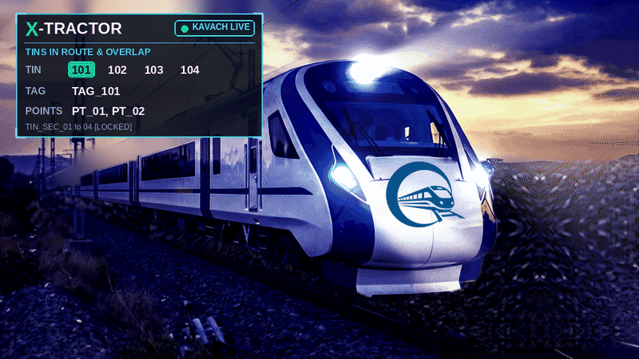

# X-Tractor: Indian Railways KAVACH Table of Control (TOC) Studio



**X-Tractor** is an automated, zero-hardcode engineering suite designed for Indian Railways signalling and KAVACH automatic train protection systems. It ingests Signal Interlocking Plans (SIP), Engineering Scale Plans (ESP), and CAD/PDF station layouts to dynamically generate compliant **KAVACH Table of Control (TOC)** tables adhering strictly to **RDSO/SPN/196/2020 Version 4.0 (Amendment 6, Effective 07.06.2024)**.

---

## 🚀 Key Automation Pillars

- **Zero Hardcoding Principle:** Operates completely dynamically on every uploaded station layout. No hardcoded signal names, track circuits, line identifiers, or coordinate systems.
- **Requires Points in Route (Both Normal & Reverse):**
  - Identifies point switches starting with `P-` (numeric or alphanumeric) from CAD vector primitives and OCR.
  - Automatically calculates Normal vs. Reverse positions using **Vector Dot Product Analysis** between line direction vector ($\vec{L}$) and tag placement vector ($\vec{T}$):
    $$\text{Alignment} = \vec{L} \cdot \vec{T}$$
    - If tag direction aligns with the line forward progression $\rightarrow$ **Normal**.
    - If tag placement opposes the line forward direction $\rightarrow$ **Reverse**.
  - Dynamically separates points within the signal-to-signal route path from trailing overlap points (*Requires Points in Overlap*).
- **Requires Track Circuit "UP" in Route:**
  - Evaluates track circuit electrical picked-UP condition ($1 = \text{UP}$, healthy & unoccupied).
  - Traverses the physical track network from Entry Signal to Exit Signal corridor.
  - Automatically includes **Berthing Track Circuits** for platform lines and loops as specified by the signalling control table.
  - Preserves strict separation from *Requires Track Circuit "UP" in Overlap*.
- **TINs Requires Free (Route & Overlap):**
  - Identifies track sections from approved RFID Tag-TIN plans.
  - Correlates track identification numbers with active routes and overlap sections.
- **Interactive Multi-Format CAD Viewer & Table Editor:**
  - Integrated vector rendering of railway lines, signals, tags, point machines, and track circuits.
  - Export to CSV, Excel, and structured JSON formats.

---

## 💻 Tech Stack & Architecture

```
┌─────────────────────────────────────────────────────────────┐
│                    Electron Desktop App                     │
│          (Windows Setup Installer, Tray, Train Icon)        │
└──────────────────────────────┬──────────────────────────────┘
                               │
            ┌──────────────────┴──────────────────┐
            ▼                                     ▼
┌───────────────────────────────┐   ┌─────────────────────────┐
│     React 19 + Vite Frontend  │   │  Local Express Backend  │
│ (Interactive TOC, Canvas CAD) │   │ (TypeScript, Node.js)   │
└───────────────────────────────┘   └─────────────┬───────────┘
                                                  │
                                                  ▼
                                    ┌─────────────────────────┐
                                    │ Native Python OCR & CAD │
                                    │ (PyMuPDF, OCR, ezdxf)   │
                                    └─────────────────────────┘
```

- **Desktop Shell:** Electron 45, electron-builder, NSIS installer.
- **Frontend:** React 19, Vite, Tailwind CSS v4, Lucide Icons.
- **Backend Service:** Express, Node.js, TypeScript, esbuild.
- **Extraction & OCR Worker:** Python 3.10+, PyMuPDF (`fitz`), Tesseract-OCR, ezdxf, Pillow.

---

## 🛠️ Installation & Prerequisites

### 1. System Requirements
- Windows 10/11 (x64)
- Node.js 18+ (LTS recommended)
- Python 3.10+
- [Tesseract-OCR for Windows](https://github.com/UB-Mannheim/tesseract/wiki) (Standard install path: `C:\Program Files\Tesseract-OCR\tesseract.exe`)

### 2. Install Project Dependencies

```bash
# Install Node dependencies
npm install

# Install Python CAD & OCR dependencies
pip install -r requirements.txt
```

---

## 🏃 Running in Development

You can run the web client and server concurrently:

```bash
# Start frontend and backend concurrently
npm run dev:all

# Or start individually:
npm run dev          # Vite frontend (http://localhost:5173)
npm run server:dev   # Express backend (http://localhost:3000)
```

To test inside the Electron desktop wrapper during development:

```bash
npm run electron:dev
```

---

## 📦 Building the Windows Setup Installer (`.exe`)

To compile the production build and generate the standalone Windows installer:

```bash
# 1-Click build for production installer
npm run dist:win
```

This generates:
- **Installer:** `dist-installer/X-Tractor Setup 1.0.0.exe`
- **Application Shortcut:** `X-Tractor` with the custom aerodynamic Train Icon.
- **Startup Experience:** Built-in Welcome Banner modal featuring the HDR animated signalling GIF.

Alternatively, use the convenience batch scripts inside `Electron/scripts/`:
- `Electron\scripts\install_prerequisites.bat` (automated dependency check)
- `Electron\scripts\build_installer.bat` (builds the setup executable)
- `Electron\scripts\start_desktop.bat` (starts the packaged desktop app)

---

## 📂 Project Structure

```text
railspectest/
├── Electron/                   # Electron packaging, NSIS config & desktop entry points
│   ├── assets/                 # Desktop icon (.ico/.png) and startup banner (.gif)
│   ├── scripts/                # Automated batch/PowerShell helper scripts
│   ├── electron-builder.json   # electron-builder packaging settings
│   ├── main.cjs                # Main process & background backend supervisor
│   ├── preload.cjs             # Context bridge
│   └── README.md               # Electron-specific desktop documentation
├── server/                     # Express backend & Python CAD/OCR workers
│   ├── cadComponentExtractor.ts# Vector line geometry & dot product calculation
│   ├── pdfOcrWorker.py         # PyMuPDF rendering & Tesseract text extraction
│   └── pdfProcessor.ts         # High-resolution rasterization and processing pipeline
├── src/                        # React 19 Frontend application
│   ├── components/             # UI components, CAD viewer, LandingPageModal
│   ├── engine/                 # KAVACH Table of Control generation engine
│   └── types/                  # Signalling & TOC data models
├── public/                     # Static assets (icon, banner)
├── requirements.txt            # Python dependencies
├── package.json                # NPM scripts and project configuration
├── tsconfig.json               # TypeScript compiler configuration
└── README.md                   # This project guide
```

---

## 📜 Specification Compliance

Implemented in strict accordance with:
- **RDSO/SPN/196/2020 Version 4.0** (Annexure-I: KAVACH Control Table Guidelines).
- **Amendment 6 (Effective: 07.06.2024)**.
- Clause I.2.11.8: *Requires Points in Route (Both Normal & Reverse)*.
- Clause I.2.11.9: *Requires Points in Overlap (Both Normal & Reverse)*.
- Clause I.2.11.10: *Requires Track Circuit "UP" in Route*.
- Clause I.2.11.11: *Requires Track Circuit "UP" in Overlap*.
- Clause I.2.11.12: *TINs Requires Free (Route & Overlap)*.

---

## 📄 License & Attribution

Designed and engineered for Indian Railways Signalling & Telecommunication (S&T) automation.
